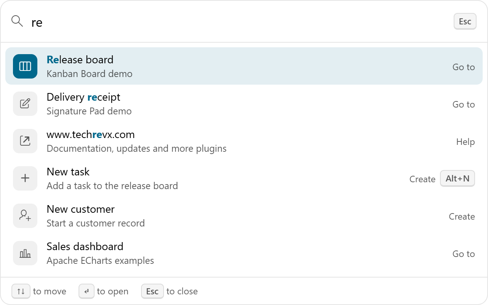

# Command Palette for Oracle APEX

A Ctrl+K search box that finds any page or command in your app and runs it from the keyboard.

[](https://oracleapex.com/ords/r/aamirkhanz/plugins/command-palette) &nbsp; Sign in as `demo` with the password `Demo`.



| | |
|---|---|
| **Type** | Region plug-in |
| **Internal name** | `COM.TECHREVX.COMMAND_PALETTE` |
| **Version** | 1.0 |
| **Requires** | Oracle APEX 26.2 or later |
| **License** | MIT |

## What it does

Command Palette gives your app the Ctrl+K search that people know from their code editor and their browser. Press it on any page, type a few letters and press Enter to open a page, run an action or start a task. Try it now: press Ctrl+K, or Cmd+K on a Mac.

- **Every page, no setup**: it lists the app's navigation menu as the user sees it, with the parent menu as a path, so conditions and authorization schemes apply.
- **Your commands**: rows of a SQL query with a title, link, group, icon, description, keywords and a shortcut to show. A command can open a link, invoke an apex.actions action, or set an item and fire an event for a Dynamic Action.
- **Fuzzy search**: "cu ed" finds Customers › Edit. Matched letters are highlighted, and recently used commands come first.
- **Keyboard first**: arrow keys, Enter, Ctrl+Enter for a new tab, Escape. Screen readers hear a labelled dialog, the active command and the number of results.
- **Anywhere**: on the Global Page with Display Hidden it works on every page; as a search button it fits a page header or a toolbar.

## At a glance

- **Commands**: rows of the region source (title, link, group, icon, description, keywords, shortcut, value, action), plus the app's Navigation Menu as the user sees it and, optionally, the page's apex.actions. JavaScript can add commands with their own function.
- **Search**: fuzzy matching on titles, paths, descriptions and keywords, with the matched letters highlighted; recently used commands come first.
- **Running a command**: opens its link, invokes its apex.actions action, sets Set Item and fires Command Palette - Command Selected for Dynamic Actions.
- **Keyboard**: the shortcut (Ctrl+K by default, Cmd+K on a Mac) opens and closes it; arrow keys, Enter and Escape. Screen readers get a labelled dialog and listbox.
- Put it on the Global Page with Display Hidden to have it on every page. JavaScript: apex.region( "id" ).open( query ), close(), refresh(), addCommands( commands ).
- No external libraries.

## Installation

1. Download `plugin/region_type_plugin_com_techrevx_command_palette.sql` from the [latest release](https://github.com/aamirkhanz/apex-plugin-command-palette/releases/latest) (or from this repository).
2. In App Builder, open your application and go to **Shared Components > Plug-ins**.
3. Choose **Import**, select the file and finish the wizard.
4. Create a region of type **Command Palette [Plug-in]**, ideally on the Global Page with Display set to Hidden.

Everything the plug-in needs is inside the SQL file; it loads nothing from other sites.

## Example

```sql
select 'New order'                    as title,
       apex_page.get_url( p_page => 12 ) as link,
       'Create'                       as grp,
       'fa-plus'                      as icon,
       'Start an order for a customer' as description,
       'add sale'                     as keywords
  from dual
union all
select 'Customer ' || cust_name, apex_page.get_url( p_page => 20, p_items => 'P20_ID', p_values => cust_id ),
       'Customers', 'fa-user', city, null
  from customers
```

Commands are loaded the first time the palette opens, not with the page, so a long list costs nothing until it is used.

## Attributes

### Commands

| Attribute | Type | Default | Description |
|---|---|---|---|
| **Title Column** (required) | Region source column |  | What the command is called, for example Open orders. Searched first. |
| **Link Column** | Region source column |  | Where the command goes: a URL such as apex_page.get_url( p_page => 10 ), #APP_FILES#guide.pdf or javascript:... Substitutions are replaced. |
| **Group Column** | Region source column |  | Heading the command is listed under, for example Pages, Create or Help. Groups appear in the order of the query. |
| **Icon Column** | Region source column |  | Font APEX icon class, for example fa-file-o. |
| **Description Column** | Region source column |  | Short text under the title. Also searched. |
| **Keywords Column** | Region source column |  | Other words that find the command but are not shown, for example synonyms. |
| **Shortcut Column** | Region source column |  | Keyboard shortcut shown next to the command, for example Ctrl+S. It is only displayed. |
| **Value Column** | Region source column |  | Value passed to Set Item and to the Command Palette - Command Selected event, for commands handled by a Dynamic Action. |
| **Action Column** | Region source column |  | Name of an apex.actions action to invoke, for example a button's action or an Interactive Grid action such as selection-add-row. |

### Palette

| Attribute | Type | Default | Description |
|---|---|---|---|
| **Also List** | Checkboxes | `nav` | Navigation Menu: every page in the app's navigation menu, as the user sees it (conditions and authorization apply), with its parent as the path. Page Actions: the labelled apex.actions of the current page, such as Interactive Grid actions. Values: `nav` Navigation Menu, `actions` Page Actions. |
| **Keyboard Shortcut** | Text | `Ctrl+K` | Opens and closes the palette, for example Ctrl+K, Ctrl+Shift+P or /. On a Mac, Ctrl also accepts Cmd. A single key such as / only works outside text fields. Leave empty for none. |
| **Display** (required) | Select list | `button` | Search Button: a search field-like button in the region that opens the palette and shows the shortcut. Hidden: nothing is shown; open the palette with the shortcut or apex.region( id ).open(), for example in the Global Page. Values: `button` Search Button, `hidden` Hidden. |
| **Placeholder** | Text | `Search or jump to...` | Text in the empty search box and on the button. |
| **Set Item** | Page item |  | Page item set to the command's value (or its title) when a command is chosen, before the Command Selected event. |
| **Recent Commands** (required) | Integer | `5` | How many recently used commands are shown first, kept in the browser. 0 turns it off. |
| **Maximum Results** (required) | Integer | `60` | Most commands listed at once; users type to narrow them down. |

## Events

Available in Dynamic Actions, and as jQuery events on the region or item:

- **Command Palette - Closed** (`tx-commandpalette-close`)
- **Command Palette - Command Selected** (`tx-commandpalette-select`)
- **Command Palette - Opened** (`tx-commandpalette-open`)

## What a command does

When the user chooses a command, the palette closes and then, in this order:

1. Set Item gets the command's value, or its title when there is no value.
2. Command Palette - Command Selected fires on the region.
3. A JavaScript command runs its function; otherwise the action in the Action column is invoked; otherwise the link opens. Ctrl+Enter or Ctrl+click opens a link in a new tab.

So a command with only a title and a value is handled by a Dynamic Action on Command Selected, for example to open a modal dialog. Links may use substitutions such as `#APP_FILES#` and `&APP_ID.`; build page links with `apex_page.get_url` so they carry the session and checksums.

## Events and JavaScript

```text
Command Palette - Opened
Command Palette - Closed
Command Palette - Command Selected   this.data = { title, value, group, link, action }
```

```javascript
apex.region( "palette" ).open();             // open, optionally with a search: open( "orders" )
apex.region( "palette" ).close();
apex.region( "palette" ).refresh();          // load the query's commands again
apex.region( "palette" ).addCommands( [
    { title: "Export to Excel", group: "Report", icon: "fa-file-excel-o", shortcut: "Ctrl+E",
      keywords: "xlsx download", action: function() { apex.region( "orders" ).call( "getActions" ).invoke( "download" ); } },
    { title: "Add row", action: "selection-add-row" }   // an apex.actions name
] );
```

### Open it from a button or a link

```javascript
javascript:apex.region('tx-palette').open();
```

### Keyboard

```text
Ctrl+K (Cmd+K)    open or close; set Keyboard Shortcut for another key, or / for one key
Up, Down          move through the commands; Page Up, Page Down jump by eight
Enter             run the command; Ctrl+Enter opens a link in a new tab
Escape            close and return to where you were
```

### Styling

The dialog is `.tx-Palette-dialog`, a command `.tx-Palette-item` (the active one has `.is-active`) and the search button `.tx-PaletteBtn`. It follows the Universal Theme colors, including dark styles.

## Repository contents

- `plugin/region_type_plugin_com_techrevx_command_palette.sql`: the plug-in, ready to import
- `src/`: the plug-in's own source (PL/SQL in `plugin.pls`, JavaScript and CSS), for reading and reviewing; the SQL file already contains it
- `apexplugin.json`: the plug-in's details for [apex.world](https://apex.world)

## License

MIT, see [LICENSE](LICENSE).

## More plug-ins

Documentation, updates and more plug-ins for Oracle APEX: [www.techrevx.com](https://www.techrevx.com)
